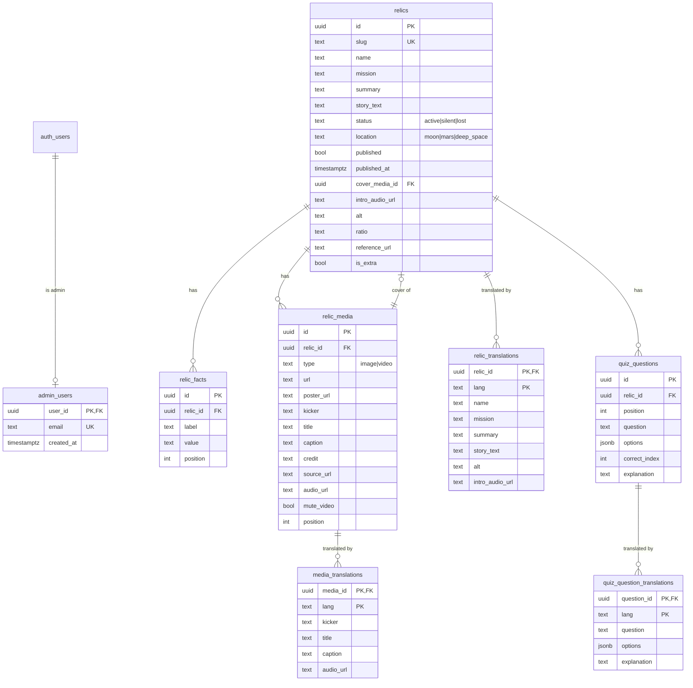

# Database schema

Postgres (Supabase) schema for Space Relics. Migrations live in
[`supabase/migrations/`](../supabase/migrations) and are applied in filename
order.

## Diagram



`auth.users` is managed by Supabase Auth. `admin_users` is the allow-list that
grants write access.

## Design decisions

| Decision | Why |
|---|---|
| `relics.cover_media_id` instead of `relic_media.is_cover` | One row can never be the cover of two relics; uniqueness is structural. The API still exposes `is_cover` on media responses. |
| `relic_facts` as label/value rows | The UI renders an arbitrary ordered fact sheet; fixed columns would not fit it. |
| Base table columns are Portuguese, translations are rows | Existing content stays valid without a translation. Missing fields fall back to the base row. |
| `caption` holds the narration text | It doubles as transcript/caption for accessibility (FE-11). |
| `audio_url` on relic + media | Intro audio and one audio per scroll step (BE-06/BE-07). |
| `jsonb options` + `correct_index` | Matches the quiz contract and is validated by a CHECK constraint. |
| Public storage bucket | The museum is public; uploads are performed server-side with the secret key, so no write policy is exposed. |

## RLS matrix

| Table | anon | authenticated (non-admin) | admin |
|---|---|---|---|
| `relics` | `select` where `published` | same | full |
| `relic_facts` | `select` when parent published | same | full |
| `relic_media` | `select` when parent published | same | full |
| `relic_translations` | `select` when parent published | same | full |
| `media_translations` | `select` when parent published | same | full |
| `quiz_questions` | `select` when parent published | same | full |
| `quiz_question_translations` | `select` when parent published | same | full |
| `admin_users` | no access | own row only if admin | full |

`public.is_admin()` is `security definer` and reads `admin_users` to avoid
recursive RLS. Public write access is denied by the absence of anon write
policies.

## `steps` derivation (BE-07)

The detail endpoint builds a deterministic list:

1. `intro` — `intro_audio_url`, the relic `story_text`.
2. One step per media row, ordered by `position`, with `audio_url`, `caption`
   and `type`.
3. `total_steps = steps.length`; the UI computes `100 / N`.

A relic without media returns only the intro step. Missing audio/caption is a
warning in the admin, not a database error.

## Translations (BE-12)

The base columns are the Portuguese source of truth; a translation is an
optional row in `relic_translations`, `media_translations` or
`quiz_question_translations`, keyed by `(id, lang)`. This keeps existing content
valid without a translation and makes the fallback a read-time concern.

- Translatable relic fields: `name`, `mission`, `summary`, `story_text`, `alt`,
  `intro_audio_url`.
- Translatable media fields: `kicker`, `title`, `caption`, `audio_url`.
- Translatable quiz fields: `question`, `options`, `explanation`.
- The public endpoints accept `?lang=` and overlay each field independently;
  missing or empty fields fall back to the base row. An invalid code resolves to
  `pt` instead of failing.
- The admin `PUT .../translations/:lang` merges with the existing row, so saving
  one tab does not erase fields managed elsewhere. An explicit `null` clears an
  audio URL.

RLS exposes translations to `anon` only when the parent relic is published.

## Quiz (BE-13)

`quiz_questions` stores one row per question, ordered by `position`. The
database already enforces 2–5 options and `correct_index < jsonb_array_length(options)`;
the API validates the same rules before writing so callers receive a clear 400
instead of a Postgres constraint error.

- `GET|POST /api/admin/relics/:id/quiz` — read the quiz with answers, or append a
  question (max 5 per relic; `position` shifts the following rows).
- `PATCH|DELETE /api/admin/quiz/:id` — edit or remove one question. Changing
  `options` re-validates the existing `correct_index`; translations cascade on
  delete.
- `PUT /api/admin/relics/:id/quiz/order` — full ordered id list, like media.
- The public detail returns `quiz` **without** `correct_index`; only admin
  responses include the answer. Admin relic responses use
  `ADMIN_RELIC_OPTIONS` in `server/utils/relicMapper.ts`.

## NASA import (BE-11)

The admin can search the official NASA Image and Video Library and import a
result into a relic. No new table is needed: the item becomes a normal
`relic_media` row.

- `GET /api/admin/nasa/search` proxies `images-api.nasa.gov/search` and
  normalises the result to `nasa_id`, `title`, `description`, `media_type`,
  `thumbnail`, `credit`, `source_url`, `date_created` and `center`. Audio
  results are filtered out.
- `POST /api/admin/relics/:id/media/import` takes `{ nasa_id }` and writes a
  media row that **references** the official asset URL instead of copying it:
  `~medium.jpg` for images, `~mobile.mp4` for videos, with a `~large.jpg`
  poster. `credit` comes from `secondary_creator`/`center` (known centers are
  expanded, e.g. `JPL` → `NASA/JPL-Caltech`) and `source_url` points to
  `https://images.nasa.gov/details/<nasa_id>`.
- Audio items are rejected with 400; NASA/network failures return 502.

## Migrations

```bash
# link once
npx supabase link --project-ref "$SUPABASE_PROJECT_REF"

# apply all pending migrations
npx supabase db push

# local stack (Docker required)
npx supabase start
npx supabase db reset   # migrations + seed
```

Generate TypeScript types after schema changes:

```bash
npx supabase gen types typescript --linked > app/types/database.types.ts
```

The checked-in [`app/types/database.types.ts`](../app/types/database.types.ts)
matches the latest migrations (`20261109000100_core_schema.sql` plus
`20261114000100_relic_references.sql`).

## Seed

[`data/relics.json`](../data/relics.json) is the single source of truth for the
demo catalogue. [`scripts/generate-seed.mjs`](../scripts/generate-seed.mjs)
turns it into [`supabase/seed.sql`](../supabase/seed.sql), and the front reads
the same JSON for its SSR fallback (`app/data/relics.ts`).

- **12 relics:** Apollo LM, Opportunity, Viking 1, Spirit, Sojourner, Ingenuity,
  Apollo Lunar Roving Vehicle, Surveyor 3, Voyager 1, Voyager 2, Pioneer 10 and
  Pioneer 11.
- Every relic has a fact sheet and 1–2 official NASA media items, each with a
  `credit` and a `source_url` (`https://images.nasa.gov/details/<nasa_id>`).
- **Idempotent:** the script deletes the demo rows by `slug` and reinserts them;
  facts, media and translations follow the `on delete cascade`. Running it twice
  leaves exactly 12 relics, 48 facts and 24 media rows.
- **Narration:** every relic has `intro_audio_url` and every media row has
  `audio_url`, pointing at the 36 synthetic MP3s in
  `public/media/narration/` (Edge TTS, PT-PT). The seed stores only the URLs;
  the files ship with the front-end.
- **Official references:** `relics.reference_url` points at the mission page or
  NSSDC record listed by the Space Apps challenge. `relics.is_extra` marks
  Voyager 1/2 as outside the official resource list, so the UI can label them.
- Local images live in `public/images/relics/` and are normalised to 1600×900
  (16:9) so the carousel and the modal share the same ratio.

Regenerate after editing the JSON:

```bash
npm run seed:generate
npm run seed:check      # CI fails if seed.sql is stale
```
