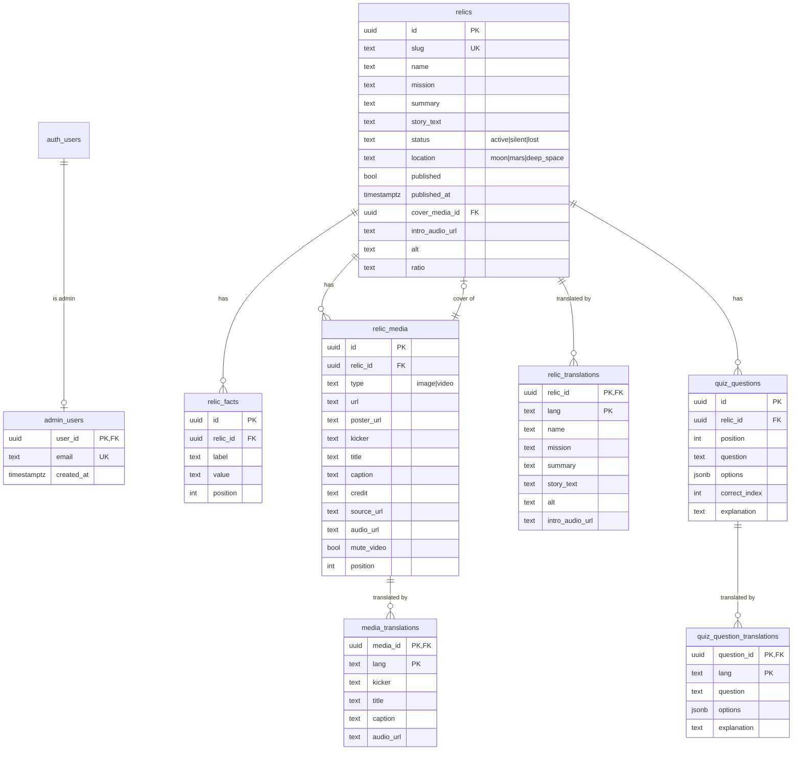

# Database schema

Postgres (Supabase) schema for Space Relics. Migrations live in
[`supabase/migrations/`](../supabase/migrations) and are applied in filename
order.

## Diagram



`auth.users` is managed by Supabase Auth. `admin_users` is the allow-list that
grants write access.

## Design decisions

| Decision | Why |
|---|---|
| `relics.cover_media_id` instead of `relic_media.is_cover` | One row can never be the cover of two relics; uniqueness is structural. The API still exposes `is_cover` on media responses. |
| `relic_facts` as label/value rows | The UI renders an arbitrary ordered fact sheet; fixed columns would not fit it. |
| Base table columns are Portuguese, translations are rows | Existing content stays valid without a translation. Missing fields fall back to the base row. |
| `caption` holds the narration text | It doubles as transcript/caption for accessibility (FE-11). |
| `audio_url` on relic + media | Intro audio and one audio per scroll step (BE-06/BE-07). |
| `jsonb options` + `correct_index` | Matches the quiz contract and is validated by a CHECK constraint. |
| Public storage bucket | The museum is public; uploads are performed server-side with the secret key, so no write policy is exposed. |

## RLS matrix

| Table | anon | authenticated (non-admin) | admin |
|---|---|---|---|
| `relics` | `select` where `published` | same | full |
| `relic_facts` | `select` when parent published | same | full |
| `relic_media` | `select` when parent published | same | full |
| `relic_translations` | `select` when parent published | same | full |
| `media_translations` | `select` when parent published | same | full |
| `quiz_questions` | `select` when parent published | same | full |
| `quiz_question_translations` | `select` when parent published | same | full |
| `admin_users` | no access | own row only if admin | full |

`public.is_admin()` is `security definer` and reads `admin_users` to avoid
recursive RLS. Public write access is denied by the absence of anon write
policies.

## `steps` derivation (BE-07)

The detail endpoint builds a deterministic list:

1. `intro` — `intro_audio_url`, the relic `story_text`.
2. One step per media row, ordered by `position`, with `audio_url`, `caption`
   and `type`.
3. `total_steps = steps.length`; the UI computes `100 / N`.

A relic without media returns only the intro step. Missing audio/caption is a
warning in the admin, not a database error.

## Migrations

```bash
# link once
npx supabase link --project-ref "$SUPABASE_PROJECT_REF"

# apply all pending migrations
npx supabase db push

# local stack (Docker required)
npx supabase start
npx supabase db reset   # migrations + seed
```

Generate TypeScript types after schema changes:

```bash
npx supabase gen types typescript --linked > app/types/database.types.ts
```

The checked-in [`app/types/database.types.ts`](../app/types/database.types.ts)
matches migration `20261109000100_core_schema.sql`.

## Seed

[`supabase/seed.sql`](../supabase/seed.sql) inserts the three demo relics
(Apollo LM, Opportunity, Viking 1). It is idempotent: relics are upserted by
slug, then their facts and media are replaced. BE-14 expands the seed to the
full nine-relic catalogue.
